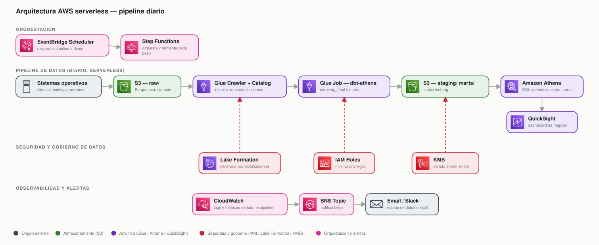

# Modelo de datos de e-commerce

Pipeline batch que toma el raw entregado en `data/ecommerce.duckdb` y lo transforma en un modelo analítico con dbt, para responder preguntas de negocio sobre clientes, ventas, ingresos y órdenes. El brief original de la prueba está en [ASSIGNMENT.md](ASSIGNMENT.md).

## Cómo correrlo desde cero

Requiere Python 3.10 o más nuevo.

```bash
git clone <este-repo>
cd craftech-dataEngineer

python3 -m venv .venv
source .venv/bin/activate      # en Windows: .venv\Scripts\activate

pip install -r requirements.txt

./run.sh
```

`run.sh` hace dos cosas:

1. `dbt build` contra `dbt_project/`, arma las capas `staging` y `marts` y corre los tests de datos.
2. `python report/build_report.py`, ejecuta las queries de `queries/` y genera `report.html` en la raíz del repo con las respuestas a las cuatro preguntas, una tabla y un gráfico por cada una. Abrilo con el navegador.

Se puede correr las dos partes por separado:

```bash
dbt build --project-dir dbt_project --profiles-dir dbt_project
python report/build_report.py
```

También se puede correr cualquiera de las queries de negocio directamente con el cliente de DuckDB, sin pasar por el script de reporte:

```bash
duckdb data/warehouse.duckdb < queries/03_ingresos.sql
```

## Qué hace el pipeline

```
data/ecommerce.duckdb (raw, solo lectura)
        │
        ▼  dbt source() + attach
dbt_project/models/staging/*   → data/warehouse.duckdb, schema staging
        │
        ▼
dbt_project/models/marts/*     → data/warehouse.duckdb, schema marts
        │
        ▼
report/build_report.py  →  report.html
```

`data/ecommerce.duckdb` nunca se modifica. dbt lo adjunta en modo lectura con `attach` en `dbt_project/profiles.yml` y lo usa como `source`. Todo lo que dbt construye vive en un archivo propio, `data/warehouse.duckdb`.

Capas:

- **staging**, o sea `stg_customers`, `stg_products`, `stg_orders` y `stg_order_items`, es una copia 1 a 1 del raw, deduplicada y tipada. No tiene lógica de negocio.
- **marts**, `dim_customers`, `fct_orders` y `fct_order_items`, es el modelo dimensional que consumen las queries de negocio.

**Incremental en lo que crece sin límite, full refresh en lo que no.** `stg_orders`, `stg_order_items`, `fct_orders` y `fct_order_items` son modelos `incremental` de dbt. Cada corrida solo procesa las filas de `raw.orders` y `raw.order_items` cuyo `_ingested_at` es posterior al último checkpoint cargado, usando `is_incremental()` y un filtro por `_ingested_at`, y hace upsert con `delete+insert` por `unique_key` en vez de reescribir todo. `dim_customers` sigue siendo `table`, full refresh, porque la cantidad de clientes crece mucho más lento que el log de eventos de órdenes y ya lee desde `fct_orders`, que es chico, no desde el raw, así que recalcularlo entero en cada corrida es barato. El primer `dbt build` sobre un `warehouse.duckdb` vacío hace la carga completa automáticamente, dbt detecta que la tabla no existe todavía, y no hace falta pasar `--full-refresh` a mano.

Una orden vieja puede recibir un evento nuevo en cualquier momento, por ejemplo se paga hoy una orden creada hace semanas, así que `fct_orders` y `fct_order_items` no solo agregan eventos nuevos como filas nuevas. Identifican qué `order_id` tuvieron actividad nueva desde el último checkpoint y recalculan el pivot completo de esas órdenes con todo su historial, no solo con el evento nuevo. Corrí el build dos veces seguidas sin agregar datos y confirmé que la segunda corrida no vuelve a tocar filas porque el checkpoint ya está al día, y los conteos finales no cambian, 15.165 eventos deduplicados, 3.998 órdenes, 7.615 líneas, idéntico a la primera corrida.

Y si lo que cambia es un cliente o un producto, no hace falta nada especial. `stg_customers` y `stg_products` no son incrementales, se reconstruyen enteros desde el raw en cada corrida, así que un cambio de nombre, segmento o precio en `raw.customers`/`raw.products` ya queda reflejado solo con correr el pipeline de nuevo.

Los tests de dbt corren junto con los modelos en el mismo comando `dbt build`, y validan claves únicas, nulos, valores esperados en `status` y `current_status`, relaciones entre tablas, y rangos razonables de `quantity` y `unit_price`.

## Las 4 preguntas de negocio

Las queries están en `queries/`, apuntan todas a `marts.*` y se pueden correr sueltas:

| Archivo | Pregunta |
|---|---|
| `queries/01_clientes.sql` | Total de clientes, activos y crecimiento mensual de la base |
| `queries/02_ventas.sql` | Ventas por día y por semana |
| `queries/03_ingresos.sql` | Ingresos totales y por categoría de producto |
| `queries/04_ordenes.sql` | Proporción de órdenes entregadas vs. canceladas |

## Decisiones y supuestos

El enunciado tiene varios puntos ambiguos a propósito. Estas son las decisiones que tomé y por qué.

**Dos archivos DuckDB, no uno.** `data/ecommerce.duckdb` queda intacto como fuente de solo lectura, todo lo construido vive en `data/warehouse.duckdb`. Es la práctica estándar de dbt, nunca escribir sobre el source, y de paso deja clara la separación entre lo que llegó del lake y lo que armamos nosotros.

**`raw.orders` es un log de eventos, no una tabla de estado.** Cada cambio de estado de una orden agrega una fila nueva, `created`, `paid`, `shipped`, `delivered`, `cancelled` o `returned`, no se pisa la anterior. `fct_orders` pivotea ese log a una fila por orden, con el timestamp de cada estado y el estado actual, el más avanzado alcanzado. Confirmé en los datos que `cancelled` es siempre terminal, nunca aparece después de `shipped` o `delivered`.

**Deduplicación.** Encontré dos problemas de calidad en el raw, ambos típicos de un pipeline de extracción real:
- `raw.orders` tiene 443 eventos duplicados exactos, mismo `order_id`, `status` y `event_at`, reingestados con otro `_ingested_at`. Se colapsan agrupando por esas tres columnas.
- `raw.order_items` tiene 205 casos donde la misma línea, la combinación de `order_id` y `line_number`, aparece con `product_id` o `quantity` distinto entre dos extracciones. Me quedo con la versión más reciente según `_ingested_at`.

**"Cliente activo"** no está definido en el raw, así que lo definí así. Tuvo un evento `paid`, `shipped` o `delivered` en los últimos 90 días respecto a la fecha más reciente que aparece en los datos, y como el dataset es histórico y fijo, uso ese máximo como si fuera "hoy". Es una ventana arbitraria, en un contexto real la ajustaría según el ciclo de compra típico del negocio.

**"Venta"** = una orden que llegó a estado `paid`, contada una sola vez en la fecha en que se pagó. Una orden que queda en `created` o se cancela antes de pagar no cuenta como venta.

**Ingresos** se reconocen en el momento del pago, en las líneas de órdenes con `is_paid = true`, al precio de catálogo actual. El raw no tiene historial de precios, así que no hay forma de saber qué precio regía cuando se hizo cada venta. El número no resta devoluciones, si negocio quisiera ingreso neto de `returned` es un filtro adicional sobre `fct_order_items`.

**Órdenes entregadas/canceladas** se calculan sobre el estado actual de cada orden, no solo sobre estados terminales, así que los porcentajes suman 100% sobre el total de órdenes, incluyendo las que todavía están en tránsito.

**`dim_customers` no tiene historial, es tipo 1.** `country_code` y `segment` muestran siempre el último valor conocido. Ninguna de las cuatro preguntas pedía ver cómo era un cliente en el pasado, así que no se justificaba un SCD tipo 2.

**Timestamps en UTC, sin ajuste por país.** Las columnas de fecha no traen timezone. Asumo que ya vienen en UTC y calculo las métricas por día/semana/mes directamente sobre esa fecha, sin convertir por el país del cliente, hay 7 países en el dataset.

**Incremental en los modelos que crecen sin límite, full refresh en el resto.** `raw.orders` es un log de eventos que crece para siempre, reescanearlo entero en cada corrida no es una decisión que escale, aunque hoy con unos miles de filas no se note. `stg_orders`, `stg_order_items`, `fct_orders` y `fct_order_items` son incrementales, con cursor por `_ingested_at` y upsert por `unique_key`. `dim_customers` se quedó en full refresh porque la cantidad de clientes crece mucho más lento y ya lee desde un mart chico, no desde el raw. El detalle de cómo funciona cada uno está en la sección [Qué hace el pipeline](#qué-hace-el-pipeline).

## Orquestación en producción

Esto no está implementado, es la propuesta de cómo llevaría este mismo pipeline a un entorno productivo. En vez de levantar un Airflow, con un scheduler y workers corriendo 24/7 para un job que se ejecuta una vez por día, lo llevaría a una arquitectura 100% serverless en AWS. Se paga por lo que corre, no hay infraestructura que mantener, y el volumen de datos de este caso, miles de filas por día, está lejos de necesitar un cluster dedicado.

Vale aclarar algo antes de entrar en el diseño. Localmente usamos dbt-duckdb, que arquitectónicamente se parece más a un data warehouse clásico, tablas relacionales dentro de un motor embebido, schema-on-write. Para producción propongo en cambio un lakehouse, S3 con tablas Iceberg más Athena, y no es porque tenga que calcar la arquitectura local, son decisiones en niveles distintos. A nivel local priorizo velocidad de iteración sin infraestructura, a nivel productivo priorizo costo y escala para el volumen real de una empresa con operación en varios países. Lo que sí se mantiene igual entre los dos es la lógica de negocio, los mismos modelos `.sql` de dbt corren en DuckDB acá y en Athena en producción, lo único que cambia es el motor de ejecución y el storage, no la transformación.



**Ingesta y almacenamiento.** Los sistemas operativos siguen extrayendo a un bucket **S3**, `raw/`, partido por fecha de extracción, en Parquet. Esa zona es inmutable, nadie escribe encima, solo se agregan particiones nuevas cada día, el mismo principio de no tocar el raw que ya usamos acá con `ecommerce.duckdb`.

**Catálogo y transformación.** Un **Glue Crawler** infiere el schema de lo nuevo en `raw/` y lo registra en el **Glue Data Catalog**, que es lo que le da a Athena, y a cualquier otro motor, visibilidad de las tablas sin tener que declarar el esquema a mano. La transformación la corre un **Glue Job** con el adapter `dbt-athena`, con los mismos modelos `.sql` que están en `dbt_project/models/`, sin cambiar ni una línea, dbt simplemente apunta a un target distinto. Ese job escribe `staging/` y `marts/` de vuelta a S3 como tablas **Apache Iceberg**, no Parquet plano. `raw/` sí se queda como Parquet con particiones Hive, nunca se actualiza, solo se le agregan particiones nuevas, así que no necesita las garantías de un formato transaccional. `staging/` y `marts/` sí las necesitan, porque son justo los modelos incrementales que hacen upsert fila por fila.

**Consulta y consumo.** **Amazon Athena** consulta `marts/` directo sobre S3 vía el Data Catalog, sin ningún servidor de base de datos corriendo. Se paga por los datos escaneados, y el particionado junto con el formato columnar de Iceberg lo mantienen bajo. **QuickSight** se conecta a Athena y reemplaza al `report.html` estático, con el mismo contenido, los mismos cuatro números de negocio, pero como dashboard vivo que se refresca solo. Si el volumen creciera a un punto donde muchos analistas concurrentes pegan contra el mismo dataset con joins pesados, el siguiente paso sería mover `marts/` a **Redshift** en vez de Athena. Para este volumen, Athena alcanza y sale más barato.

**Orquestación.** **EventBridge Scheduler** dispara una ejecución de **Step Functions** una vez por día. La state machine encadena Crawler, Glue Job, tests de calidad, los mismos `dbt test` que ya corren acá, y el refresco del dataset de QuickSight, con reintentos automáticos por paso y manejo nativo de errores con `Catch`, sin tener que escribirlo a mano. Es el reemplazo serverless de un Airflow, no hay un scheduler corriendo en segundo plano, Step Functions solo existe mientras el pipeline está corriendo.

**Seguridad y gobierno de datos.** Cada Glue Job corre con su propio **IAM Role** de mínimo privilegio, lee `raw/` y escribe solo en su zona de salida, ningún job tiene permiso de escritura sobre `raw/`. **Lake Formation** gobierna permisos a nivel tabla y columna sobre el Data Catalog. Por ejemplo, el equipo de BI puede leer `dim_customers` pero sin ver `email`, `first_name` o `last_name`, mientras que un proceso interno sí tiene acceso completo, así se gobierna la PII sin duplicar tablas. **KMS** cifra los buckets en reposo.

**Observabilidad.** **CloudWatch** centraliza logs y métricas de cada Glue Job y de la state machine, duración, filas procesadas, DPUs usadas. Una alarma dispara un **SNS Topic** si el pipeline falla o si fallan los tests de datos, y notifica por email o Slack al equipo de datos.

**Por qué esto y no Airflow o MWAA.** Para un batch diario y simple como este, un Airflow, autogestionado o MWAA, implica un scheduler corriendo todo el tiempo para disparar un trabajo que tarda minutos. Step Functions junto con EventBridge da la misma orquestación, dependencias, reintentos, alertas, sin esa infraestructura ociosa. Si el pipeline creciera en complejidad, muchas más tablas, dependencias cruzadas entre equipos, necesidad de backfills complejos con lógica propia, ahí sí Airflow vía MWAA empieza a justificarse por su UI de DAGs y su ecosistema de operators.

**Idempotencia y backfill.** `stg_orders`, `stg_order_items`, `fct_orders` y `fct_order_items` son incrementales tanto acá como en AWS. El Glue Job corre el mismo `dbt build`, así que hereda el mismo cursor por `_ingested_at`. Lo que cambia es el mecanismo de upsert, acá en DuckDB usamos `delete+insert`, y en Athena, gracias a que `staging/` y `marts/` son tablas Iceberg, dbt-athena soporta `incremental_strategy='merge'`, que hace exactamente lo mismo a nivel de fila, upsert por `unique_key`, en vez de tener que sobrescribir la partición completa como obligaría Parquet plano. Reprocesar un día viejo es volver a invocar la state machine con esa fecha como parámetro, y como el merge es por `unique_key`, repetirlo no duplica nada.

Todo esto, buckets, roles de IAM, Glue Jobs, la state machine, se definiría como código con Terraform o AWS CDK, no manualmente desde la consola. No lo implementé, es una descripción de diseño, no código que corre.

## Uso de IA

Usé Claude Code para:
- Inspeccionar el `ecommerce.duckdb` real, conteos, duplicados, transiciones de estado de las órdenes, antes de diseñar el modelo, en vez de asumir la estructura de los datos a ciegas.
- Planificar antes de programar, usando el modo plan de Claude Code para dejar por escrito la arquitectura propuesta (capas, materializaciones, formato del reporte) y revisarla conmigo antes de tocar código, en vez de ir directo a generar archivos.
- Discutir decisiones de arquitectura punto por punto, por ejemplo dbt-duckdb con `warehouse.duckdb` separado del raw, o lakehouse con Iceberg en vez de Parquet plano en la propuesta de AWS, corrigiendo el resultado cuando algo no cerraba del todo.
- Escribir los modelos SQL, los tests de dbt, el script del reporte, el generador del diagrama de arquitectura AWS y este README.
- Verificar cada cambio corriendo el pipeline de verdad, `dbt build` con los tests, reconstrucción desde un entorno limpio, chequeo de que los números del reporte no se movieran, en vez de asumir que el código generado funcionaba sin probarlo.
